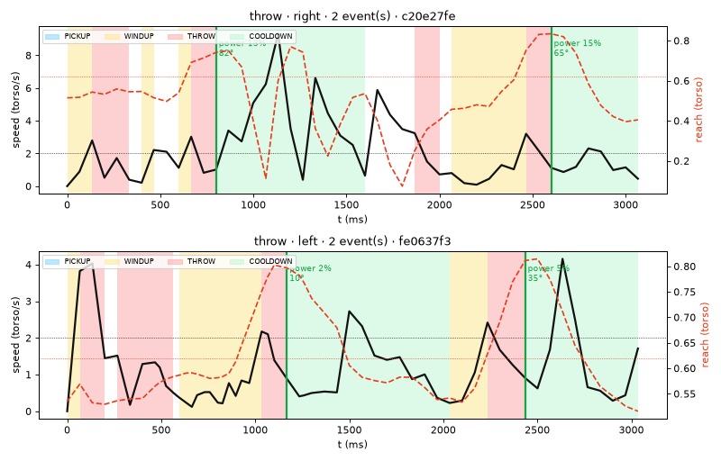

# AirHoops Engine

The motion engine behind **[AirHoops](https://airhoops.vercel.app)**, a basketball game you play by throwing at your webcam.

This repo is where the throw detector is designed, tuned and tested against real recordings. It also holds the
project's build log. The game itself lives in two sister repos:

| Repo | What |
|---|---|
| **airhoops-engine** (this one) | Python lab: throw-detection research, tuning, parity fixtures, recordings, docs |
| [airhoops](https://github.com/sammy440/airhoops) | Next.js frontend: camera, pose tracking, game, multiplayer UI |
| [airhoop-api](https://github.com/sammy440/airhoop-api) | FastAPI backend: guest auth, rooms, server-side physics referee, leaderboards |

> **Privacy:** no video ever reaches this repo or any server. Recordings are body-landmark numbers only.

## How a throw becomes a shot

```
webcam frame
  └─► MediaPipe Pose (in the browser)        33 landmarks per frame
       └─► One Euro filter                    removes jitter, keeps fast motion snappy
            └─► kinematics                    wrist speed, angle, reach, height, in torso lengths
                 └─► throw detector           state machine → ThrowEvent {power, angle, arc}
                      └─► launch mapping      speed + angle (per-player calibration)
                           └─► physics        deterministic 2D sim: rim, backboard, net
```

Everything up to the throw event runs in the player's browser. Multiplayer clients send only
`{power, angle, arc, t}`; the API re-runs the same physics to decide every shot.

### Why torso length

Distances are measured in **torso lengths** (shoulder midpoint → hip midpoint), after converting MediaPipe's
coordinates to square units. In the first recordings, shoulder width swung about 40× as players turned side-on to
throw, while torso length moved about ±10%. So a "fast" throw means the same thing whatever the player's size
or distance from the camera.

### The detector

```
IDLE ⇄ PICKUP ⇄ WINDUP          (informational: where the hand is)
  └─(arm extending fast, wrist ≥ ~shoulder)─► THROW
THROW ─(reach peaks or speed falls to 70% of peak)─► validate ─► ThrowEvent
COOLDOWN ─(800 ms)─► IDLE        THROW ─(> 900 ms)─► IDLE
```

A throw only counts if it looks like a shot, not a gesture:

| Rule | Value | Rejects |
|---|---|---|
| Set point: hand nearly still just before | median speed ≤ 1.2 torso/s over 300 ms | waving |
| Peak wrist speed | ≥ 1.8 torso/s | slow reaches |
| Reach at release / reach gained | ≥ 0.5 / ≥ 0.12 torso | flicks, small pushes |
| Release height | wrist ≥ 0.4 torso above the shoulder, **or** ≥ shoulder level going up ≥ 30° (beginner chest push) | hand raises, scratching your head, low waves |
| Direction | ≥ 5° above horizontal | sideways swipes |
| Duration | 100–900 ms | raising hands into position, stalls |

**Elbow snap**, a second way to count a throw. A push towards the camera barely gains reach in 2D, so it
also counts when, from a still two-handed set overhead, the elbow straightens fast:

| Rule | Value | Rejects |
|---|---|---|
| Set: elbow bent, both hands up and together, hand still | elbow ≤ 150°, both wrists ≥ 0.2 torso above the shoulders, ≤ 0.8 torso apart, median speed ≤ 1.2 torso/s for 200 ms | one-handed waves and head scratches, waving (never pauses) |
| Snap: elbow straight, wrist up and rising | elbow ≥ 145° within 500 ms, opening ≥ 80°/s, wrist ≥ 0.35 torso above the shoulder and rising | raising the hands into the set |
| A real push | peak wrist speed ≥ 1.8 torso/s, going up (≥ 5°) | elbow jitter while holding the set |

On the Oct 31 aimed clips it took recall from 72% to 94% (30 of 32 throws); head scratching and dribbling still
never trigger; a two-handed overhead wave triggers once.

**Power and jump.** Power comes from the arm's speed *relative to the shoulders*; a jump (shoulders rising faster
than 0.8 torso/s, full at 2.4, in the half-second before release) adds to it. Standing throws rose 0.2–0.8,
jumping ones 1.4–2.7. So jumping isn't needed to throw, but jumping harder than in calibration throws further.

**Aim.** Lean: the shoulders shifted sideways over the hips at release, against the player's own straight lean
(calibration). Dead zone 0.01 torso, 100° of launch aim per torso, ±12°. Turning the body (MediaPipe depth) was
tried first and dropped: ±30° of noise standing square, and left/right swap when side-on.

Thresholds live in `lab/airhoops_lab/detector.py` (`Params`) and in the frontend's
`src/lib/pose/throwDetector.ts` (`DEFAULT_THROW_PARAMS`). They must stay identical; the parity fixtures enforce it.

### Dribbling

A hand patting up and down at least 0.3 torso below its shoulder bounces the ball (frontend
`src/lib/pose/dribbleDetector.ts`, either hand): a downward stroke of ≥ 1.0 torso/s and ≥ 0.1 torso of travel
that turns back up is one bounce; bounces 300–1000 ms apart are a dribble. When both hands pat on the same
beat (common: the first dribble recording swings both wrists ~0.5 torso per beat, in step) it's one bounce,
and the ball stays in the hand it was already in. It's cosmetic (the ball drops to the
floor and back in time with the player's rhythm) and can't fire a shot: throws need a still hand first, and
dribbling never pauses. Movement in that low zone also doesn't count towards choosing the throwing hand, so
dribbling with one hand and shooting with the other works. Checked against one 18 s dribble recording (the
frontend replays it in `dribbleDetector.test.ts`, and it's a non-throw clip in every evaluation). More
**Dribble** clips from other people, rooms and speeds are the next step.

### Current results

On the recordings in `lab/recordings/` (7 labelled clips: 4 throw, 3 non-throw: wave, scratch head, dribble):

| Metric | Result | Target |
|---|---|---|
| Throw clips detected | 4 / 4 (100%) | ≥ 90% |
| Non-throw clips that triggered | 0 / 3 (0%) | < 10% |
| Dribble pats bounced (steady part of the dribble clip) | 16 / 16, each within 250 ms | |

That's a small dataset. More recordings (especially different rooms, lighting, clothing and left-handed
shooters) are the most useful contribution you can make. See below.



## Quick start

```bash
cd lab
python3 -m venv .venv && .venv/bin/pip install -r requirements.txt

.venv/bin/python -m airhoops_lab.evaluate          # metrics with the current thresholds
.venv/bin/python -m airhoops_lab.evaluate --tune   # grid search (needs ≥ 5 clips per class)
.venv/bin/python -m pytest tests                   # lab tests
.venv/bin/jupyter lab notebooks/                   # explore visually
```

Full workflow (recording, tuning, exporting parity fixtures): [`lab/README.md`](lab/README.md).

## Contributing recordings

1. Open the [Tracking Lab](https://airhoops.vercel.app/lab) (or `/lab` on a local frontend).
2. Pick a label with keys **1–6** (throw, wave, scratch head, idle, catch, dribble) and press **R** to record.
   About 20 throws and 20 non-throws per session is ideal.
3. Press **Download all** and add the JSON file to `lab/recordings/` in a pull request.

A recording is a JSON file of landmark numbers (shoulders, elbows, wrists, index fingers, hips) per frame, plus
the label, the throwing hand, the frame size and the fps. No images.

## Keeping the three repos in sync

| What | Source of truth | Mirror | Checked by |
|---|---|---|---|
| Smoothing, kinematics, detector | `airhoops/src/lib/pose/*.ts` | `lab/airhoops_lab/*.py` | `python -m airhoops_lab.parity` exports fixtures → frontend `npm test` replays them |
| Physics, launch mapping, scoring | `airhoops/src/lib/game/*.ts` | `airhoop-api/app/game/*.py` | 480 shared shot cases (`GEN_PARITY=1 npx vitest run src/lib/game/parity.gen.test.ts` → API `pytest`) |

Change both sides together, regenerate the fixtures, and run both test suites.

## Repo layout

```
lab/
├─ airhoops_lab/
│  ├─ load.py          load clips / "Download all" bundles into numpy arrays
│  ├─ kinematics.py    Python port of the browser pipeline (One Euro + torso-normalized kinematics)
│  ├─ detector.py      Python port of throwDetector.ts
│  ├─ evaluate.py      metrics + grid-search tuning CLI
│  ├─ parity.py        exports fixtures for the frontend replay test
│  ├─ classifier.py    optional learned classifier (does ML beat the state machine?)
│  └─ plots.py         notebook plot helpers
├─ notebooks/          01 explore · 02 release detection · 03 classifier
├─ recordings/         labelled landmark recordings (JSON)
├─ reports/            figures exported from the notebooks
└─ tests/
docs/
├─ weeks/              build log, week by week (what was built, decisions, "done when" checks)
└─ launch-post.md
```

## Known limitations

- **No depth.** A single webcam can't see how far the hand travels toward the screen, so power comes from wrist
  speed in the image plane. Per-player calibration absorbs most of the difference.
- **One Euro lag scales with distance.** Players far from the camera see slightly more smoothing lag while
  speed ramps up (about 5%).
- **Small dataset.** See *Current results*.
